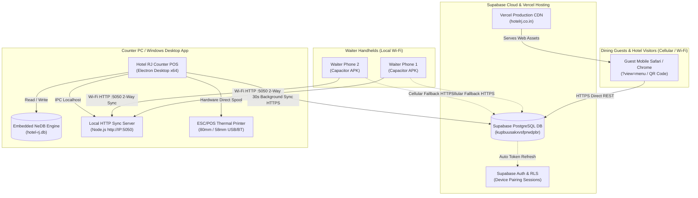
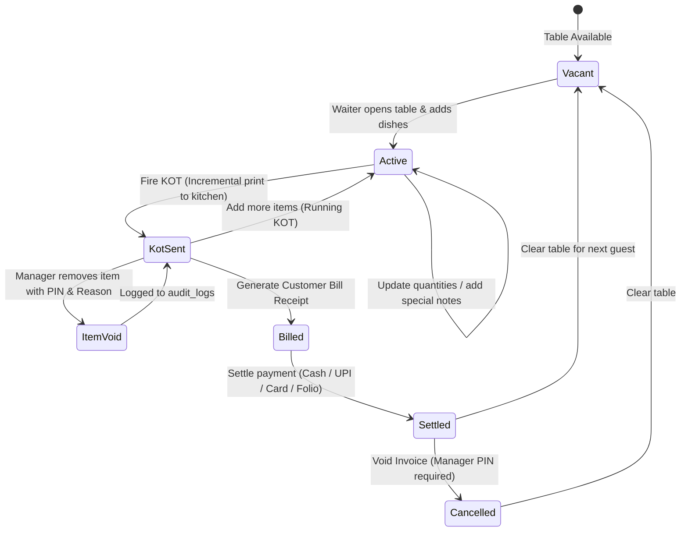
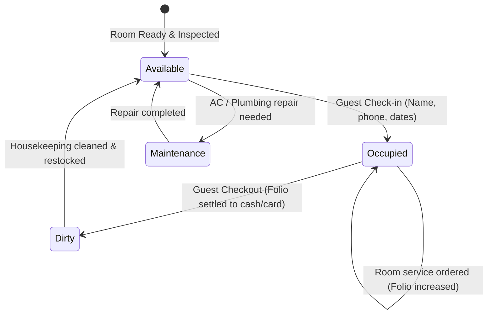
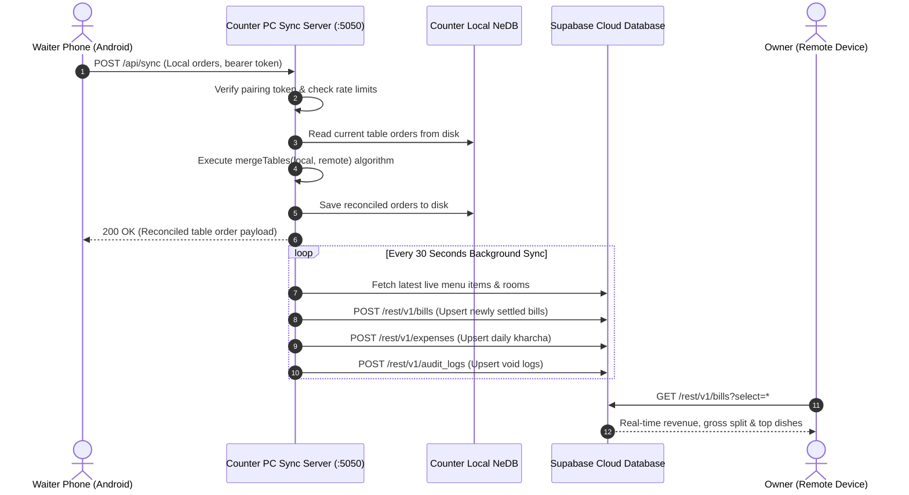
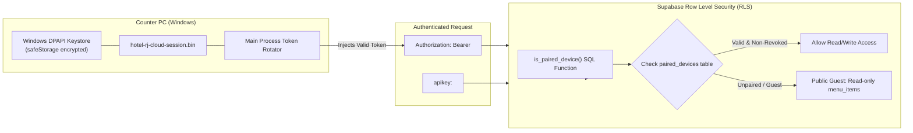

# Hotel RJ — Complete System Architecture, Schema & Feature Guide

This document is the definitive technical blueprint and feature manual for the **Hotel RJ** platform. It details the multi-device architecture, data schemas, synchronization protocols, security model, and functional capabilities across the Web, Android POS, and Windows Counter POS platforms.

---

## 1. System Architecture & Multi-Device Topology

Hotel RJ operates as a hybrid local-and-cloud architecture designed for high-throughput restaurant and hotel operations with zero downtime, even during broadband internet outages.

### Component Roles

1. **Windows Counter POS (Electron App)**:
   - Primary operational hub at the cash register.
   - Hosts the local embedded database (NeDB) and prints customer bills/KOT slips via thermal receipt printers.
   - Runs the built-in HTTP sync server on port `5050` on the local restaurant subnet (e.g. `192.168.1.35:5050`).
   - Runs a 30-second bidirectional cloud synchronizer with Supabase to stream settlements, room updates, and kitchen sold-out states.
2. **Waiter Handheld POS (Android Capacitor App)**:
   - Waiter tablets and mobile phones running the native APK.
   - Communicates with the Counter PC over local Wi-Fi for instantaneous table updates, order dispatch, and KOT generation.
   - If Wi-Fi disconnects or is out of range, falls back directly to the Supabase Cloud REST API via 4G/5G mobile data.
3. **Public Guest Digital Menu (Vercel SPA)**:
   - Interactive contactless menu accessed by guests scanning tabletop QR codes.
   - Served globally via Vercel CDN; fetches live availability and real-time prices directly from Supabase Cloud.
4. **Supabase Cloud Database & Auth**:
   - Central PostgreSQL instance providing real-time data persistence, automated cloud backups, remote Owner Insights analytics, and device pairing token verification.

---

## 2. Database Schema & Entity-Relationship Model

```mermaid
erDiagram
    BILLS ||--o{ BILL_ITEMS : contains
    BILLS {
        text id PK
        bigint bill_number
        text status "settled | cancelled"
        text cancel_reason
        text cancelled_by
        timestamptz cancelled_at
        text department "restaurant | rooms | banquet"
        text table_id
        text order_type "dine-in | takeaway | room-service | banquet"
        text room_number
        text server_name
        text settled_by
        text customer_phone
        text customer_name
        numeric subtotal
        numeric tax
        numeric discount
        numeric total
        text payment_method "cash | upi | card | room-folio | split"
        jsonb items
        text date_str
        timestamptz timestamp
        timestamptz created_at
    }

    MENU_ITEMS {
        text id PK
        text category_id
        text category_title
        text name
        text hindi_name
        numeric price
        text dietary "veg | non-veg | egg"
        text image
        boolean is_available
        boolean popular
        text description
        timestamptz updated_at
    }

    ROOMS {
        text id PK
        text name
        text tier "deluxe | executive | family"
        numeric price_per_night
        text status "available | occupied | dirty | maintenance"
        integer max_guests
        text bed_type
        text guest_name
        text check_in_date
        text check_out_date
        numeric folio_amount
        text notes
        timestamptz updated_at
    }

    TABLES_CONFIG {
        text id PK
        text name
        text section "dining | parcel | lawn | banquet"
        integer capacity
        boolean is_active
        integer sort_order
        timestamptz updated_at
    }

    AUDIT_LOGS {
        text id PK
        text type "ITEM_VOID | KOT_CANCEL | MANUAL_DISCOUNT | KITCHEN_86"
        text table_id
        text staff_name
        text item_name
        numeric item_price
        integer quantity
        text reason
        text date_str
        timestamptz timestamp
        timestamptz created_at
    }

    EXPENSES {
        text id PK
        text category "Vegetables | Dairy | Meat | Grocery | Maintenance | Staff"
        numeric amount
        text paid_by
        text notes
        text recorded_by
        text date_str
        timestamptz timestamp
        timestamptz created_at
    }

    PAIRED_DEVICES {
        uuid session_id PK
        text label
        timestamptz paired_at
        boolean revoked
    }

    APP_SETTINGS {
        text key PK
        jsonb value
        timestamptz updated_at
    }
```

### Table Specifications

#### 1. `bills`
Stores completed guest settlements across all hotel departments.
- **Indexes**: `idx_bills_date_str (date_str)`, `idx_bills_department (department)`, `idx_bills_timestamp (timestamp DESC)`.
- **Key Columns**:
  - `status`: `'settled'` for valid sales; `'cancelled'` for manager-authorized voids.
  - `payment_method`: Supports `'cash'`, `'upi'`, `'card'`, `'room-folio'`, or `'split'`.
  - `items`: Structured JSON array of ordered dishes, quantities, unit prices, dietary tags, and custom preparation instructions.

#### 2. `menu_items`
Source of truth for the restaurant menu and kitchen sold-out statuses.
- **Indexes**: `idx_menu_items_available (is_available)`, `idx_menu_items_category (category_id)`.
- **Key Columns**:
  - `is_available`: Boolean flag (`true` = available, `false` = Kitchen 86 sold out).
  - `image`: URL/relative path to bundled food photography.
  - `price`: Live base dish price.

#### 3. `rooms`
Real-time occupancy and housekeeping state for the hotel's 10 rooms.
- **Indexes**: `idx_rooms_status (status)`.
- **Key Columns**:
  - `status`: `'available'` (ready for booking), `'occupied'` (guest checked in), `'dirty'` (awaiting housekeeping), or `'maintenance'`.
  - `folio_amount`: Accumulated restaurant/room-service charges billed directly to the room.

#### 4. `tables_config`
Configurable physical dining tables, parcel takeaway counters, lawn tables, and banquet slots.
- **Indexes**: `idx_tables_config_section (section)`.
- **Key Columns**:
  - `section`: Grouping tag (`'dining'`, `'parcel'`, `'lawn'`, `'banquet'`).
  - `is_active`: Soft-enable/disable toggle for tables during maintenance or renovations.

#### 5. `audit_logs`
Anti-theft audit trail capturing staff actions that adjust revenue or void tickets.
- **Indexes**: `idx_audit_logs_timestamp (timestamp DESC)`.
- **Key Types**:
  - `ITEM_VOID`: Fired item removed from active table order.
  - `BILL_CANCEL`: Settled invoice cancelled by manager PIN.
  - `KITCHEN_86`: Dish marked unavailable in live menu.

#### 6. `expenses`
Daily petty cash expenditures (daily kharcha) paid from the cash drawer.
- **Indexes**: `idx_expenses_date_str (date_str)`.
- **Categories**: Vegetable market, milk/dairy, poultry/fish, cleaning, daily labor.

#### 7. `paired_devices` & `app_settings`
Security infrastructure for hardware authorization.
- `paired_devices`: Registry of approved waiter phones and Counter POS laptops tied to owner Supabase authentication sessions.
- `app_settings`: Key-value store holding the argon2/bcrypt hash of the owner's manager PIN.

---

## 3. Core Workflows & State Machines

### 3.1 Order & Billing Lifecycle

### 3.2 Hotel Room Occupancy & Folio Lifecycle

---

## 4. Multi-Device Synchronization Engine

Hotel RJ features a hybrid synchronization architecture ensuring sub-second updates inside the restaurant and real-time cloud analytics for remote owners.

### Conflict Resolution: High-Watermark Merging

When multiple waiters update the same table simultaneously, `mergeTables()` resolves conflicts without losing items:

1. **Timestamp Check**: Compares `updatedAt` timestamps between local and remote state.
2. **Unfired Item Retention**: If a waiter adds items locally while another waiter bills the table remotely, any local item where `quantity > firedCount` is preserved and merged into the active ticket.
3. **Cumulative High-Watermark**: `quantity` and `firedCount` resolve to `Math.max(local, remote)` to prevent accidental deletion of already-cooked dishes.

---

## 5. Security & Hardware Authorization

### Protection Mechanisms

1. **Staff Never Log In**: Staff members do not manage passwords or emails. The restaurant owner enters a one-time pairing code to authorize each phone or POS laptop.
2. **Windows DPAPI Vault**: On Counter POS laptops, pairing session tokens are encrypted at rest using Windows Data Protection API (`safeStorage`), preventing session theft.
3. **Manager PIN with Anti-Brute-Force Lockout**:
   - Bill voids, item cancellations, and Owner Insights require the Manager PIN.
   - 5 failed attempts trigger an automatic exponential time lockout (e.g. 5 minutes).
4. **Row-Level Security (RLS)**:
   - Public guests on `https://hotelrj.co.in` can only execute `SELECT` queries on `menu_items`.
   - Modifying bills, viewing revenue, or toggling room statuses requires a valid session registered in `paired_devices`.

---

## 6. Detailed Feature Deep Dive

### Feature 1: Waiter POS & Kitchen Order Tickets (KOT)
- **Table Visualizer**: Displays dining tables, garden lawn tables, parcel counters, and banquet halls with live color coding (Grey = Vacant, Green = Active dining, Amber = KOT fired, Purple = Billed).
- **Fast Dish Selection**: Categories with instant search by dish name, Hindi phonetic name, price, or acronym (e.g., typing `cmc` matches `Crispy Corn Chilly`).
- **Custom Cooking Instructions & Charges**: Supports custom preparations (e.g., "Extra spicy, no onion") and custom weight cooking charges (e.g., customer brings own fish/chicken $\rightarrow$ charged ₹180/kg cooking fee).
- **Incremental KOT Firing**: Only unfired dishes are printed when tapping "Send to Kitchen". Dishes already cooking are not duplicated on new slips.

### Feature 2: Digital QR Menu & Kitchen 86 (Sold-Out Tracking)
- **Zero-Friction Access**: Works on any guest smartphone without app installation.
- **Real-Time Sold-Out Toggles**: If chicken soup or paneer tikka sells out, the kitchen flips the toggle on the Counter POS or Waiter app. The digital menu immediately updates with a `[SOLD OUT]` badge and disables the dish.
- **Food Image Hydration Engine**: Bundled high-resolution food images are cached locally and preserved in fallback lookups. Cloud updates to prices or availability never clear or break dish photos.
- **Mixed-Content Protection**: Automatically detects HTTPS web environments and routes cloud queries directly over HTTPS, eliminating mixed-content security blocks on guest mobile browsers.

### Feature 3: Counter Cashier Operations & ESC/POS Thermal Printing
- **Silent Hardware Spooling**: In Electron, prints receipts directly to USB/Bluetooth 80mm and 58mm POS thermal printers without opening system print dialogs.
- **Split Payment Support**: Allows guests to split invoices across multiple modes (e.g., ₹500 in Cash + ₹1,200 via PhonePe/GPay UPI).
- **Auto-Calculated CGST & SGST**: Automatically formats GST breaks, customer FSSAI details, and restaurant address headers.

### Feature 4: Hotel Operations & Room Folio Billing
- **Interactive Room Grid**: Real-time room status tracker for 10 guest rooms (Deluxe, Super Deluxe Executive, and Family Suites).
- **Room Folio Transfer**: Restaurant and room-service food orders can be transferred directly to a guest's room folio, unifying lodging and dining onto a single checkout invoice.
- **Housekeeping Turnaround**: Updates rooms to `'dirty'` upon checkout, signaling cleaning staff, and transitions back to `'available'` once inspected.

### Feature 5: Owner Insights & Anti-Theft Audit Trail
- **Multi-Department Granularity**: Separate revenue reporting for Restaurant Dining, Hotel Lodging, and Banquet Hall events.
- **Date Filtering**: Toggle daily, yesterday, last 7 days, monthly, and yearly revenue with payment mode breakdowns.
- **Audit Void Log**: Every item cancellation records who cancelled the dish, the table number, price, quantity, timestamp, and mandatory cancellation reason.
- **One-Click Backup & Export**: Generates combined Excel-compatible CSVs and JSON backups of all settled bills, expenses, and audit logs.

### Feature 6: Network Fallbacks & Offline Resilience
- **Smart Protocol Routing**: Waiter phones prefer high-speed Wi-Fi HTTP (`http://192.168.1.X:5050`). If Wi-Fi drops, requests automatically re-route through Supabase Cloud REST over 4G/5G cellular data.
- **DHCP Drift Protection**: Waiter POS UI highlights Counter IP connection changes and guides waiters with one-click reconnects.

---

## 7. Deployment & CI/CD Pipeline

| Target | Deployment Method | Trigger | Artifact / Output |
|---|---|---|---|
| **Digital Menu & Website** | Vercel SPA CDN | Push to `main` branch | Live at `https://hotelrj.co.in` |
| **Android Waiter App** | GitHub Actions (`build-apk.yml`) | Push to `main` branch | `HotelRJ-POS-Waiter-App/app-debug.apk` |
| **Windows Counter POS** | Local Electron Builder | `npm run electron:build` | `dist-electron/Hotel RJ Counter POS Setup 1.0.0.exe` |

---

*Hotel RJ System Documentation — Created for Hotel RJ Operations & Engineering.*
